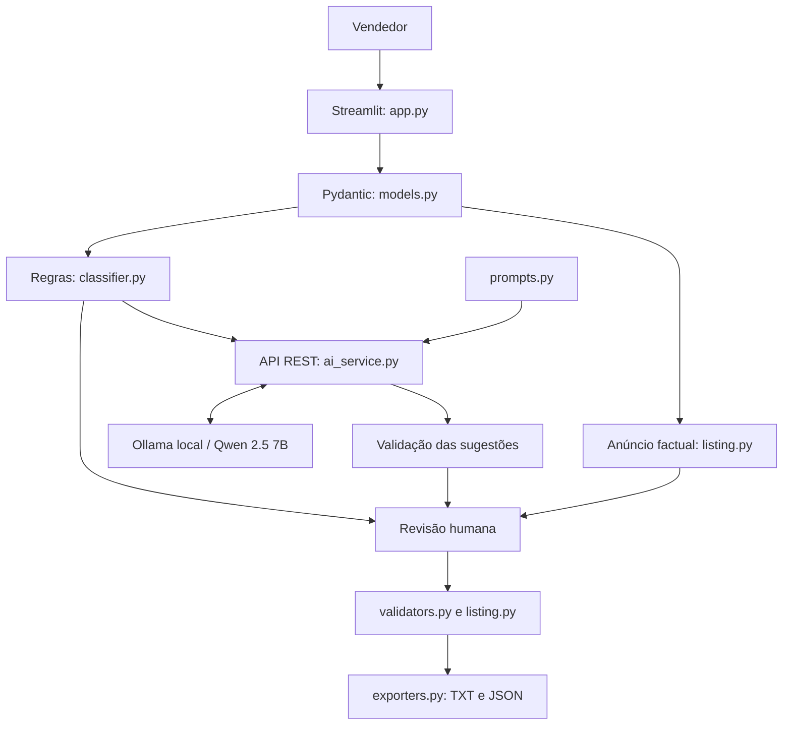

# Anuvex

**Inteligência por trás de cada anúncio.**

Assistente inteligente para criação e complementação de anúncios em marketplaces. Projeto educacional independente de portfólio, inspirado em desafios de qualidade de anúncios, sem vínculo com a OLX. Versão 4.2.

## Problema e solução

Anúncios incompletos dificultam decisões de compra. Modelos generativos podem acrescentar características não informadas. O Anuvex combina um LLM local, regras determinísticas e supervisão humana: o modelo sugere categorias e perguntas, enquanto o Python monta o anúncio exclusivamente com dados fornecidos pelo vendedor.

## Funcionalidades

- Formulário web com validação Pydantic e preço em Decimal.
- Classificação híbrida: regras para produtos conhecidos e IA para os demais.
- Sugestões de informações complementares, correção manual da categoria e confirmação de respostas.
- Anúncio factual, indicador de preenchimento e alertas heurísticos de consistência.
- Exportação TXT e JSON; fallback para anúncio factual quando a API falha.
- Interface personalizada em lilás e laranja.

## Arquitetura



[Detalhes da arquitetura](docs/arquitetura.md)

## Tecnologias

Python 3.12, Streamlit, Requests, Pydantic 2, Ollama, Qwen 2.5 7B, Pytest e Git. Pipeline de CI proposto com GitHub Actions.

## Como executar (Windows / PowerShell)

Pré-requisitos: Python 3.12, [Ollama](https://ollama.com/download) instalado e em execução, espaço em disco e memória suficientes para o modelo. A execução local não utiliza AWS nem APIs pagas.

Na raiz do projeto:

```powershell
python -m venv .venv
.\.venv\Scripts\python.exe -m pip install -r requirements.txt
ollama pull qwen2.5:7b
.\.venv\Scripts\python.exe -m pytest -q
.\.venv\Scripts\python.exe -m streamlit run app.py --server.address 127.0.0.1
```

Abra http://127.0.0.1:8501. Não é necessário ativar o ambiente virtual. Para encerrar, pressione Ctrl+C.

## Estrutura

| Arquivo | Responsabilidade |
|---|---|
| app.py | Interface e estado da sessão |
| models.py | Esquemas e validação de dados |
| classifier.py | Classificação e perguntas por regras |
| ai_service.py | Comunicação HTTP e validação da resposta |
| prompts.py | Instruções para o modelo |
| validators.py | Respostas complementares e consistência |
| listing.py | Anúncio factual e completude |
| exporters.py | Exportação e formatação monetária |
| styles.py | Identidade visual |
| config.py | Configurações |
| tests/ | Testes automatizados |
| .github/workflows/ci.yml | Pipeline de integração contínua |

## Testes e integração contínua

Na versão 4.2, 35 testes passaram no Windows (0,60 s na execução registrada). Incluem regras de negócio, validação, exportação e integração HTTP simulada. O pipeline executa compilação e Pytest em Python 3.12 a cada push ou pull request, sem carregar um modelo real. A execução no GitHub ainda precisa ser confirmada após a publicação. Os testes não equivalem a cobertura integral nem a uma auditoria certificada.

## Segurança e limitações

- Dados do vendedor não são necessariamente verdadeiros. O anúncio factual evita texto livre inventado pela IA, mas categorias e perguntas ainda podem estar incorretas.
- Prompt injection não é totalmente mitigado. O modelo não executa ferramentas nem publica anúncios.
- Completude mede preenchimento dos critérios avaliados; não mede veracidade ou qualidade comercial.
- Alertas usam heurísticas, incluindo bateria abaixo de 90% em produto declarado novo. Não são normas oficiais de marketplace.
- Texto sem significado, dimensões sem unidade e erros ortográficos ainda podem ser aceitos.
- Dependências diretas fixadas; transitivas não travadas e sem auditoria de vulnerabilidades concluída.
- Mantenha a aplicação em loopback. Não exponha à internet sem autenticação e revisão adicional.
- O teste manual final confirmou o fluxo de anúncio, mas não comprovou isoladamente uma chamada real bem-sucedida ao Ollama nessa versão.

## Autor

Matheus Olimpio da Silva — projeto de aprendizado e portfólio, desenvolvido com apoio de IA e validação prática local.
