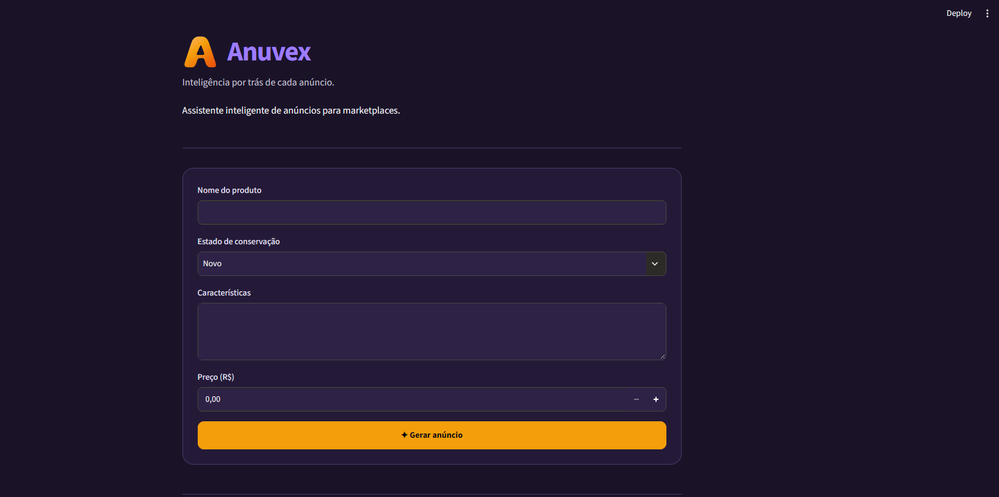
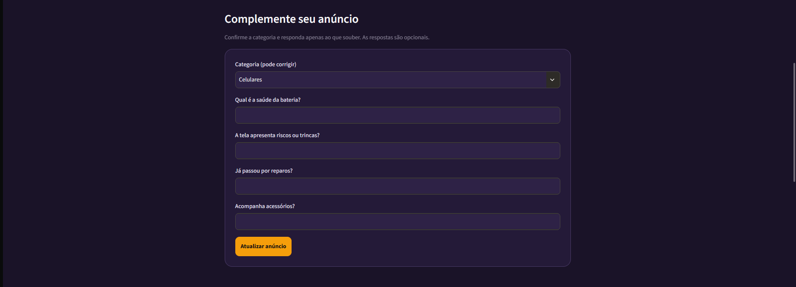
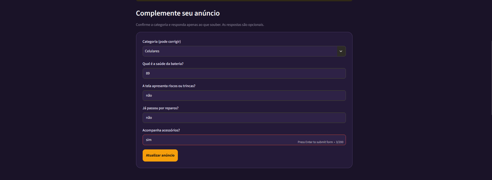
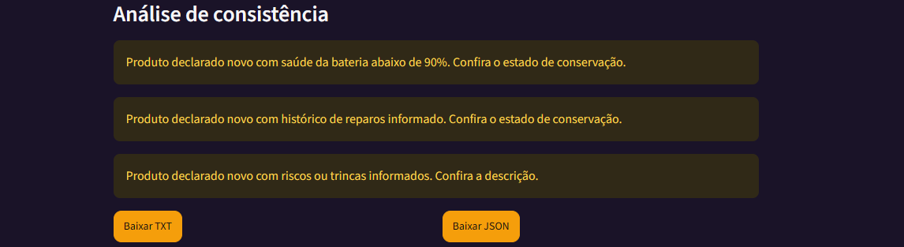
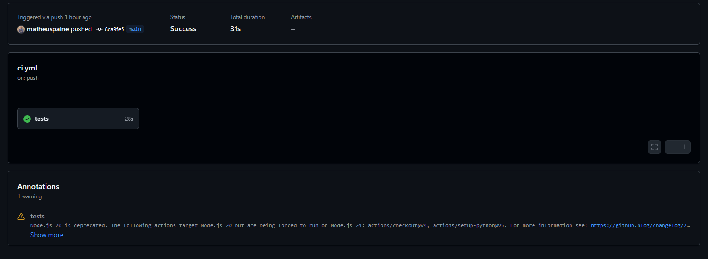

# Anuvex

**Inteligência por trás de cada anúncio.**

Assistente inteligente de anúncios para marketplaces, com **LLM local**, **classificação híbrida**, **validação de dados**, **supervisão humana** e **testes automatizados**.


---

## Sobre o projeto

O **Anuvex** é uma aplicação desenvolvida para ajudar na criação de anúncios de produtos para marketplaces.

A proposta do projeto é combinar:

- **regras determinísticas**
- **validação estruturada**
- **supervisão humana**
- **inteligência artificial local (Ollama + Qwen)**

para gerar anúncios mais organizados, consistentes e seguros.

O sistema não publica anúncios automaticamente. Ele atua como um **assistente de apoio**, ajudando o usuário a estruturar melhor as informações antes da publicação.

---

## Problema de negócio

Ao anunciar produtos em marketplaces, é comum encontrar problemas como:

- descrições incompletas
- informações inconsistentes
- falta de padronização
- erros de preenchimento
- baixa qualidade dos anúncios

O **Anuvex** foi criado para reduzir esses problemas por meio de:

- coleta guiada de informações
- classificação sugerida por IA
- perguntas complementares por categoria
- validações de consistência
- exportação estruturada em TXT e JSON

---

## Principais funcionalidades

- Geração de anúncio factual com base nos dados informados
- Classificação híbrida de produtos
- Perguntas complementares por categoria
- Análise de consistência entre os dados
- Indicador de completude do anúncio
- Exportação em **TXT** e **JSON**
- Integração com **LLM local** via Ollama
- Testes automatizados com **Pytest**
- Pipeline de **CI com GitHub Actions**

---

## Tecnologias utilizadas

- **Python 3.12**
- **Streamlit**
- **Pydantic**
- **Requests**
- **Pytest**
- **Ollama**
- **Qwen**
- **Git / GitHub**
- **GitHub Actions**

---

## Arquitetura da solução

O projeto foi organizado em módulos para separar responsabilidades:

- `app.py` — interface e fluxo principal
- `models.py` — modelagem e validação de dados
- `classifier.py` — classificação híbrida
- `ai_service.py` — comunicação com o modelo local
- `prompts.py` — engenharia de prompt
- `validators.py` — regras de negócio e consistência
- `listing.py` — construção do anúncio
- `exporters.py` — exportação dos dados
- `styles.py` — identidade visual
- `config.py` — configurações da aplicação

Documentação complementar:
- `docs/arquitetura.md`

---

## Demonstração da aplicação

### Tela inicial


### Complementação inteligente do anúncio


### Complementação preenchida


### Anúncio final gerado


### Análise de consistência


### Integração contínua com GitHub Actions


---

## Qualidade e testes

O projeto possui **35 testes automatizados**, cobrindo regras de negócio, validações e cenários críticos.

### Resultado local
- **35/35 testes aprovados**

### Integração contínua
O repositório utiliza **GitHub Actions** para executar automaticamente:

- instalação de dependências
- compilação dos arquivos Python
- execução dos testes automatizados

---

## Como executar o projeto

### 1. Clonar o repositório
```bash
git clone https://github.com/matheuspaine/anuvex.git
cd anuvex