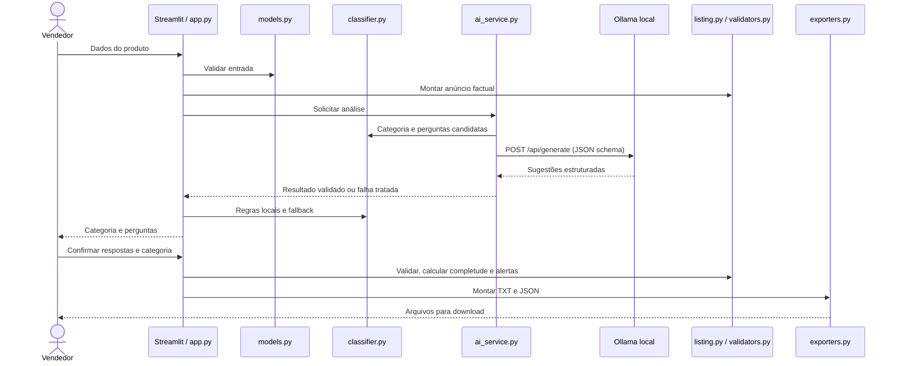

# Arquitetura do Anuvex 4.2

O diagrama representa o fluxo lógico, não uma infraestrutura AWS implantada.

## Fronteiras e decisões

O Streamlit escuta em 127.0.0.1:8501 e o Ollama em localhost:11434. O modelo recebe dados do produto e retorna sugestões, não o texto final. Para teclado, celular e sofá, a interface utiliza perguntas candidatas determinísticas; para demais tipos pode utilizar as sugestões validadas do modelo. O estado da sessão mantém as respostas durante a interação, sem banco de dados persistente. Em falhas da API, o anúncio factual permanece disponível; a classificação local ou a categoria Outros é usada. A revisão humana é necessária antes de publicação externa.
